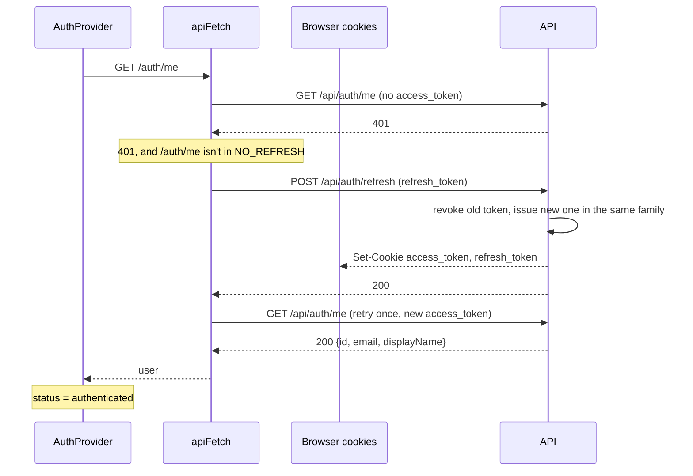
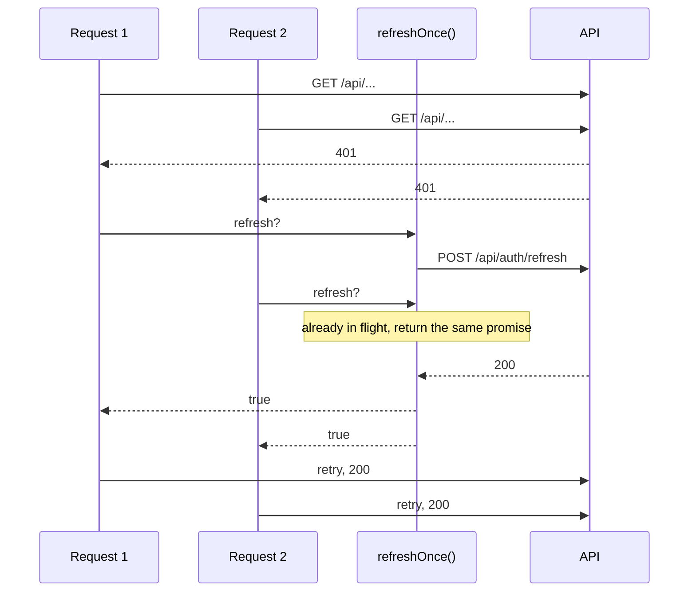
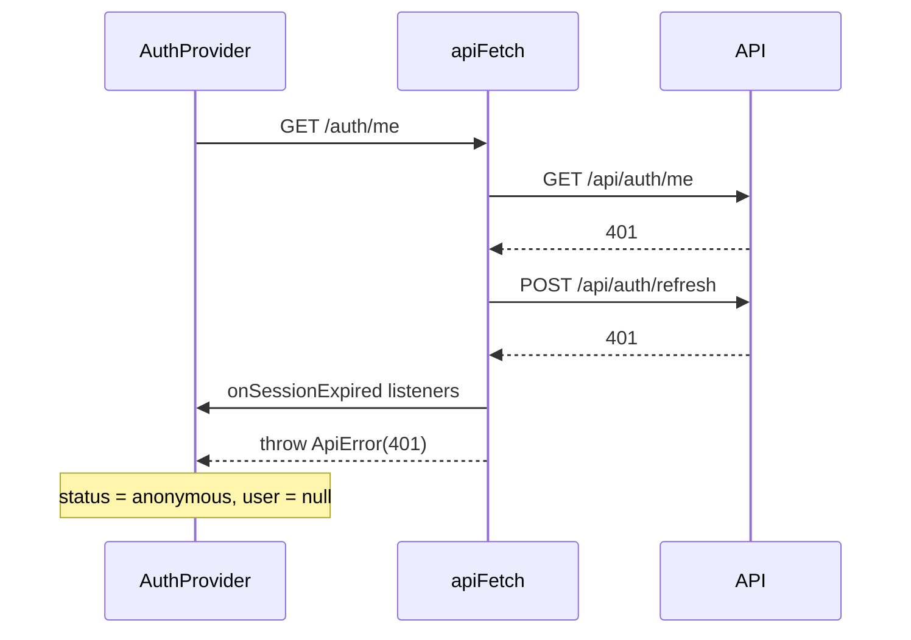
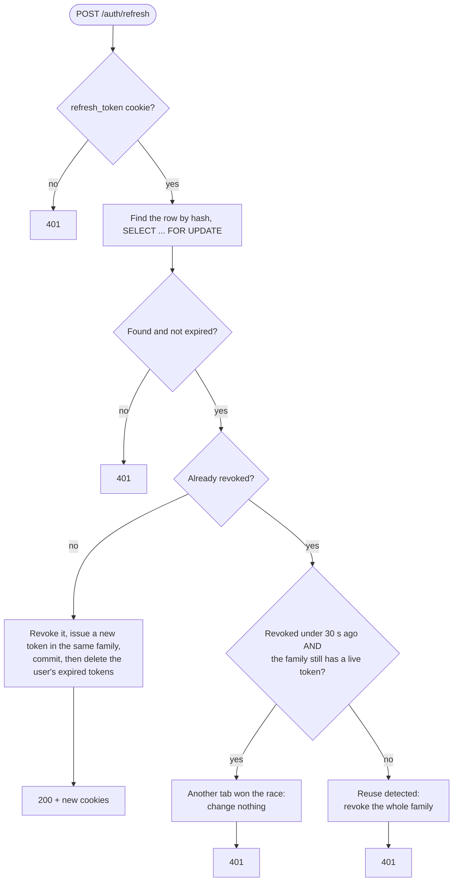

# Sessions: access tokens, refresh and sign-out

How a signed-in browser stays signed in. The server side is
`api/app/auth/tokens.py` and the `/refresh` and `/logout` routes in
`api/app/auth/router.py`; the browser side is `src/lib/api.ts` (`apiFetch`) and
`src/hooks/auth/AuthProvider.tsx`. The design spec
(`docs/superpowers/specs/2026-11-09-auth-design.md`, "`POST /refresh`" and
"Frontend") records the rules; this page shows how they play out.

## Two cookies

| Cookie | Holds | Lifetime | Sent to |
|---|---|---|---|
| `access_token` | A signed JWT naming the user | 15 min | every `/api/...` request |
| `refresh_token` | A random token; the DB stores only its hash | 30 days | only `/api/auth/...` |

Both are `httpOnly` (page JavaScript can't read them) and `SameSite=Lax`. The
frontend never handles a token: the browser sends the cookies, and
`AuthProvider` only mirrors *who* is signed in.

Each sign-in starts a **family**: the first refresh token and every token that
replaces it share one `family_id`. Logging out, or a detected theft, revokes
the whole family.

## Page load with an expired access token

The common case. The access token is gone after 15 minutes, but the refresh
token is still good, so the user notices nothing.

## Several 401s at once share one refresh

If two requests both get a 401, they must not refresh separately. The second
refresh would send the token the first one just replaced, and the API treats a
replaced token as stolen. `refreshOnce()` keeps one in-flight promise that
every caller awaits; it resets once it settles.

In development this happens on every page load: React StrictMode mounts
`AuthProvider` twice, so two `/auth/me` calls race (see "Verified in the
browser" below).

## When the refresh fails

The refresh token is missing, expired, revoked or unknown. `apiFetch` doesn't
retry; it notifies the `onSessionExpired` listeners and throws the original
401. `AuthProvider` listens and switches to signed out.

`/auth/code`, `/auth/verify`, `/auth/refresh` and `/auth/logout` never trigger
a refresh (`NO_REFRESH` in `api.ts`). A 401 there means "wrong code" or "no
session", and refreshing `/auth/refresh` itself would loop.

## What `/auth/refresh` decides

- **The grace window** covers two tabs refreshing at once: the losing tab sends
  the old token a moment after the winning tab replaced it, and the shared
  cookie jar already holds the new one. The replay still gets no tokens; the
  window only stops it from ending the session.
- **Commit before the 401.** A rejected token may have just revoked its family,
  and returning the 401 without committing would undo that.
- **Expired-token cleanup runs in its own transaction**, after the rotation
  commits. Inside the rotation's transaction it locked every row of the user,
  including another device's new token, so two devices refreshing at once
  could deadlock (MySQL error 1213).

## Signing out

`signOut()` calls `POST /auth/logout`, which revokes the family (if the cookie
maps to a token) and clears both cookies with the same Paths they were set
with. It always returns 204. `AuthProvider` switches to signed out in a
`finally`, so a failed request still signs the user out locally.

## Verified in the browser

Checked 2026-11-11 against the dev servers in Chrome, with a throwaway user:

1. **Only a refresh token** (as after the access token expires), then reload:

   | # | Request | Status |
   |---|---|---|
   | 1 | `GET /api/auth/me` | 401 |
   | 2 | `GET /api/auth/me` | 401 |
   | 3 | `POST /api/auth/refresh` | 200 |
   | 4 | `GET /api/auth/me` | 200 |
   | 5 | `GET /api/auth/me` | 200 |

   Two `/me` calls (StrictMode's double mount) got 401 together and shared
   **one** refresh, then both retried and succeeded.

2. **An unknown refresh token**, then reload: two `/me` 401s, one
   `/auth/refresh` 401, and nothing after it. No retry, no loop, no console
   errors.

To repeat check 1 by hand: sign in, delete only the `access_token` cookie in
DevTools (Application → Cookies), reload, and watch the Network tab.
