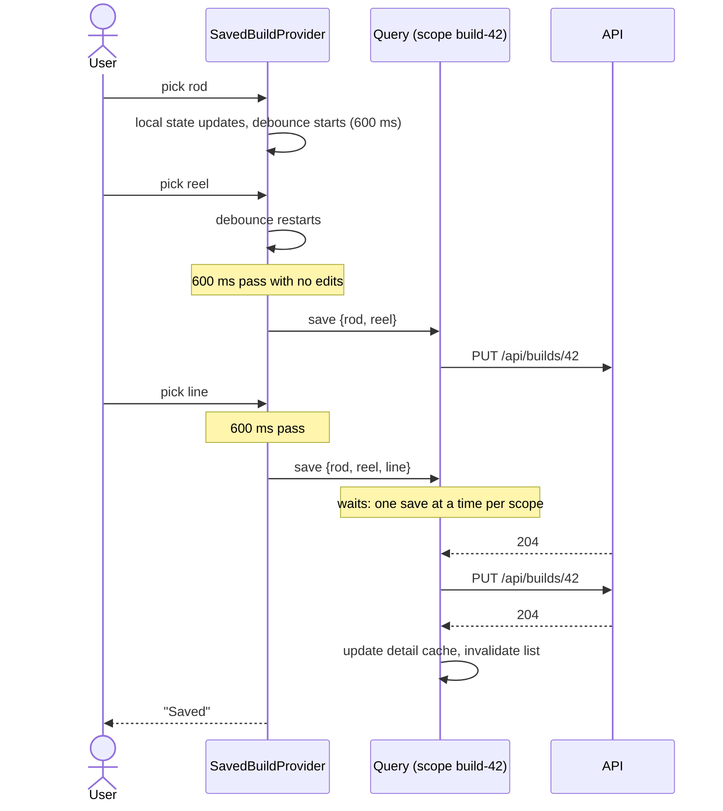

# Saved builds: drafts, ownership and autosave

How a fishing rod build moves from a signed-out draft in the browser to a
build saved in the user's account, and how edits to a saved build reach the
API. The server side is `api/app/builds/router.py`; the browser side is
`src/features/builder/` (`hooks/LocalBuildProvider.tsx`,
`hooks/SavedBuildProvider.tsx`, `components/SaveDraftButton.tsx` and
`api/builds.ts`). The design spec
(`docs/superpowers/specs/2026-11-12-saved-builds-design.md`, "API" and
"Frontend") records the rules; this page shows how they play out.

## Who owns a build

Every row in `builds` has a `user_id` (migration 019, `NOT NULL`,
`ON DELETE CASCADE`). Every `/api/builds` route takes `CurrentUserId`, so a
request without a valid access cookie gets a 401 before any database work.

| Route | Behavior |
|---|---|
| `GET /api/builds` | The caller's builds, `ORDER BY updated_at DESC, id DESC` |
| `POST /api/builds` | Creates a build owned by the caller. 201 with `BuildOut` |
| `GET /api/builds/{id}` | The build if the caller owns it, else 404 |
| `PUT /api/builds/{id}` | Replaces name and parts if the caller owns it, else 404. 204 |
| `DELETE /api/builds/{id}` | Deletes it if the caller owns it, else 404. 204 |

- **The owner comes from the cookie, never the body.** `create_build` sets
  `user_id` from `CurrentUserId`. `BuildIn` has no `userId` field, so a client
  can't create a build for someone else, and a `userId` it sends anyway is
  ignored like any unknown field.
- **Someone else's build is a 404, not a 403.** `_get_owned_build(db,
  build_id, user_id)` does every lookup by id and raises the same 404 for
  "missing" and "not yours". A 403 would confirm that the id exists; a 404
  reveals nothing. Because every route goes through that one helper, no route
  can forget the ownership check.
- `BuildOut` doesn't expose `userId`: the client already knows who it is.

## Two providers

The builder pages (`BuilderPage`, `BrandPartsPage`) don't know where a build
is stored. They read it through `useBuild()`, and one of two route layouts
provides it. The context value is a union on `kind`, so the type checker makes
each page handle both modes.

| Provider | `kind` | Stored in | Who |
|---|---|---|---|
| `LocalBuildProvider` | `'draft'` | `localStorage` key `rpp:build:v2` | anyone, signed in or not |
| `SavedBuildProvider` | `'saved'` | the API, autosaved | the build's owner (behind `RequireAuth`) |

Both give `build`, `basePath`, `selectPart`, `removePart` and `clearBuild`.
The pages build their links from `basePath` (`/builder` or `/builder/42`), so
picking a rod while editing build 42 stays in build 42. Saved mode adds `id`,
`name`, `rename`, `saveStatus` and `retrySave`.

### Routes

From `src/routes/AppRoutes.tsx`:

```
/builder                              BuilderLayout (catalog query)
├── (LocalBuildProvider)              pathless layout route
│   ├── index                         BuilderPage
│   └── :component/:brand             BrandPartsPage
├── saved                             RequireAuth → MyBuildsPage (next PR)
└── :buildId                          RequireAuth → SavedBuildProvider
    ├── index                         BuilderPage
    └── :component/:brand             BrandPartsPage
```

- React Router ranks the static `saved` above the dynamic `:buildId`.
- `SavedBuildProvider` shows "Build not found" for a `:buildId` that isn't a
  positive integer, without calling the API.
- `BuilderLayout` loads the parts catalog once for both providers, so
  `getPart` is always ready below it.

## Saving a signed-out draft

A visitor can try the builder before signing up. **Save build** sends them to
sign in and back, and the save finishes on its own once they return. The
`save=1` query parameter is the intent: a build is only created when someone
clicked **Save build**, so signing in for another reason never turns leftover
picks into a surprise "Untitled build".

```mermaid
sequenceDiagram
  actor U as User
  participant B as /builder (draft)
  participant L as /login (and /welcome)
  participant A as API

  U->>B: Save build
  B->>L: /login?next=/builder?save=1
  U->>L: email + code
  L->>A: POST /api/auth/verify
  A-->>L: session cookies
  L->>B: /builder?save=1
  B->>A: POST /api/builds {name: "Untitled build", parts}
  A-->>B: 201 {id: 42}
  B->>B: clear local draft, drop ?save
  B->>U: /builder/42
```



Where this lives:

- **The button:** `SaveDraftButton` in
  `src/features/builder/components/SaveDraftButton.tsx`, rendered by
  `BuilderPage` below the build table, right-aligned under the Total, in
  draft mode only. It's disabled while the draft is empty or
  the session is still loading. Signed out, it navigates to
  `/login?next=%2Fbuilder%3Fsave%3D1`; signed in, it runs the save directly.
- **The round trip:** `LoginPage` sends the user to `safeNext(next)` (query
  strings survive), or through `/welcome?next=...` for a new account, which
  passes `next` along. Both use `replace`, so `/login` doesn't stay in history.
- **The save:** one `useMutation` in `SaveDraftButton`. Its `mutationFn` is
  `createBuild(toBuildIn(draft, 'Untitled build', getPart))`. `toBuildIn`
  (`api/builds.ts`) sends only part ids that resolve in the catalog, so a part
  removed since the draft was made is dropped instead of triggering the API's
  400. On success it calls `clearBuild()`, invalidates `buildKeys.list()` and
  navigates to `/builder/${id}`. While pending, the button reads "Saving…";
  on error, "Couldn't save your build, try again" shows and the draft is
  untouched.
- **The `save=1` intent:** an effect in `SaveDraftButton` watches
  `searchParams.get('save')` and the auth `status`. While `loading` it waits.
  Otherwise it removes `save` from the URL (`setSearchParams` with
  `replace`), and, when `authenticated` with a non-empty draft, runs the same
  mutation. If the draft is empty by then (another tab cleared it), it only
  removes the parameter.
- **Once only:** a `started` ref marks the save as begun. React StrictMode runs
  effects twice in development, and refs survive that re-run, so the build is
  created once.
- **Clearing the draft for real:** `clearBuild` in `LocalBuildProvider` writes
  the empty draft to `localStorage` right away, not only from its effect. The
  navigation to `/builder/42` unmounts the provider, and the effect for the
  cleared state might never run, which would bring the old draft back on the
  next visit to `/builder`.

Since `/builder?save=1` is replaced by `/builder`, pressing Back on the new
build lands on `/builder` with an empty draft, and nothing saves again.

## Editing a saved build: autosave

A saved build has no "unsaved changes" state. Every change saves itself after
a short pause, and saves of one build run one at a time, in order.



Where this lives (all in `src/features/builder/hooks/SavedBuildProvider.tsx`):

- **Load:** `SavedBuildLoader` runs `useQuery` on `buildKeys.detail(id)` with
  `getBuild`. It shows "Loading build…", "Build not found" for a 404 (no
  retries: the shared `QueryClient` in `src/lib/queryClient.ts` doesn't retry
  4xx errors), or the error with **Try again**.
- **Seed once:** `SavedBuildEditor`, keyed by the build id, takes the loaded
  build as its initial `useState` (see the next section).
- **Debounce:** an effect compares the current `toBuildIn(...)` JSON with
  `lastSent` (what the server already has) and restarts a 600 ms timer on
  every change. An edit that changes nothing, and StrictMode's extra effect
  run, send nothing.
- **Ordering:** the `useMutation` calling `updateBuild` has
  `` scope: { id: `build-${id}` } ``. Query runs mutations with the same scope
  one at a time, so an earlier full-build `PUT` can never land after a later
  one and undo the latest edit.
- **On success:** `setQueryData` writes the sent values into
  `buildKeys.detail(id)` (reopening the build is instant and current) and
  `invalidateQueries` marks `buildKeys.list()` stale.
- **Status:** `saveStatus` is `'saving'` while a debounce is pending or a
  request is running, `'error'` after a failed save, else `'saved'`.
  `BuildHeader` shows "Saving…", "Saved" or "Couldn't save" with **Retry**
  (`retrySave` resends the current state; so does the next edit).
- **Leaving:** unmounting flushes a pending debounce at once, and a
  `beforeunload` handler asks before the tab closes while `saveStatus` is
  `'saving'`.
- **Rename:** the title is an inline input. A name that's empty once trimmed
  shows "Give your build a name" and isn't sent; saves keep the last valid
  name.

## Why local state is seeded once

The editor copies the loaded build into its own `useState` and never reads the
query cache again. From then on, local state is the source of truth for the
page.

If the editor read the cache directly, a background refetch (on window focus,
say) could overwrite an edit in progress: a rename halfway through typing, or
a part picked a moment before the refetch answered. Seeding once rules that
out. The cache still gets the latest values, because every successful save
writes them into `buildKeys.detail(id)`, so leaving and reopening the build
shows what was saved.

Keying `SavedBuildEditor` by the id gives a different build a fresh editor
(and lets the old one flush its pending save).

## Signing out and other users

`AuthProvider` (`src/hooks/auth/AuthProvider.tsx`) calls
`queryClient.removeQueries({ queryKey: ['builds'] })` on sign-out and when the
session expires. The next user who signs in on that browser never sees the
previous user's builds from the cache. The catalog and compatibility caches
stay, since they're public.

## Known limitation: the session expires mid-edit

If the 30-day session expires while a saved build is being edited, the last
unsaved change can be lost. The save's `PUT` gets a 401, `apiFetch` fails to
refresh, and `AuthProvider` goes anonymous. `RequireAuth` then sends the user
to sign in and back to the build, which reloads from the server without that
last edit. Short sessions (the 15-minute access token) don't cause this:
`apiFetch` refreshes them and retries the save without the user noticing (see
`docs/auth/sessions.md`).
