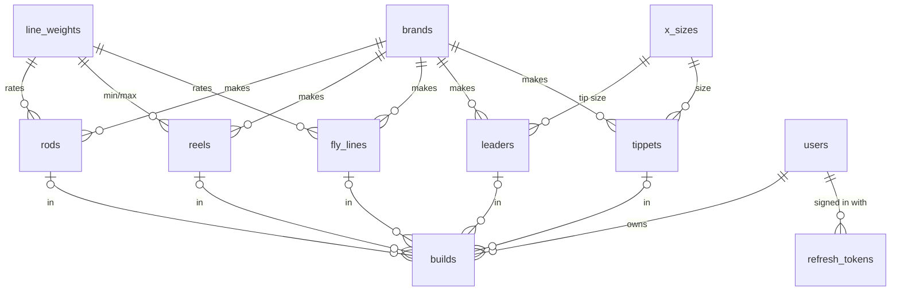

# Database Schema & Backend — Design Record

**Date:** 2026-10-11
**Status:** Schema and API skeleton implemented; not yet run against a live MySQL server
**Implementation:** `api/migrations/`, `api/app/`

This document records *how* we arrived at the RodPartPicker data model, not
only what it is: the starting proposal, the problems found in it, each decision
with the alternatives we weighed, and how the result was verified.

---

## 1. Problem

RodPartPicker lets a user assemble a fly fishing setup (rod, reel, fly line,
leader, tippet) the way PCPartPicker assembles a PC. The database must:

1. Store a catalog of parts with the specs that matter for buying them.
2. Store the specs needed to **check compatibility** between parts.
3. Store **builds**: a named selection of one part per category.

The front end currently runs on mock data (`src/features/builder/api/mockParts.ts`).
The database and API replace it.

## 2. Process

| Stage | What we did | Output |
|---|---|---|
| 1. Initial proposal | Team listed the entities and attributes we knew we needed | 8-table draft (§3) |
| 2. Domain review | Checked the draft against fly fishing domain rules and normalization (3NF) | Findings (§4) |
| 3. Deliberation | Wrote down open questions; team chose an option for each | Decision log (§5) |
| 4. Design | Rewrote the schema around those decisions, MySQL-specific | `001_init.sql` (§6) |
| 5. Backend choice | Compared a hosted backend (Supabase) with a self-built API | Decision D7 (§5) |
| 6. Implementation | Migrations, migration runner, Express API (later replaced by FastAPI, see D11), Vite proxy | `api/` |
| 7. Verification | Type check, lint, live smoke tests (§8) | Results and known gaps |

## 3. Initial proposal

| Table | Attributes |
|---|---|
| Rod | speed, length, price, id (brand/name) |
| Reel | price, id (brand/name) |
| Line | id (brand/name), sink rate, head weight, price |
| Leader | id (brand/name), material, length, strength, price, number in pack |
| Tippet | material, strength, brand/name, price |
| Standard Weights | weight (for 30 ft line heads) |
| Weight | weight (for all rods, reels, lines) |
| Fresh or Salt | fresh or salt |

## 4. Review findings

1. **"Weight" and "Standard Weights" describe the same thing.** A "5-weight"
   is a rating class, defined by AFTMA as the grain weight of the first 30 ft
   of line. One lookup table, one row per class 1–15, serves rods, reels and
   lines. Matching on that class is the main compatibility check.
2. **Reels are rated for a range** (e.g. 4–6 wt), not a single weight, so a
   reel needs a minimum and a maximum.
3. **"Fresh or Salt" as a table can't say "both"**, and a two-row table adds a
   join for nothing. It becomes a column on each product.
4. **`brand/name` as the primary key is fragile.** Names change, composite
   string keys make joins awkward, and one product line comes in many sizes,
   so brand + name doesn't identify one purchasable item.
5. **Missing attributes needed for compatibility:**
   - leader and tippet **X-size** (how anglers match tippet to leader)
   - fly line **type** (floating/sinking) and **sink rate**
   - rod **line weight** and **pieces**
6. **Missing entity: builds.** The app has a "Completed Builds" page, but
   nothing stored a build.

## 5. Decision log

| # | Question | Options considered | Decision | Why |
|---|---|---|---|---|
| D1 | Which database? | PostgreSQL, MySQL | **MySQL 8.0.16+** | Team choice. 8.0.16 is the first version that enforces `CHECK` constraints |
| D2 | How are prices stored? | One price per item; a `prices` table per retailer | **One price** (`DECIMAL(8,2)`) | Enough for the capstone; a retailer table can be added later without changing existing tables |
| D3 | How is a product line with many sizes modeled? | One flat row per size; model table + variant table | **One flat table per category**, one row per size (migrations 003, 005; originally model + variant tables) | Each category shares only one or two specs across sizes, so the split cost a join and a second insert per product for little gain. The builder UI lists parts per brand, not model-then-size. Builds still point at the exact size bought |
| D4 | Users? | Accounts now; later | **Now**: email-code sign-in, with `users`, `login_codes` and `refresh_tokens` (migration 016; originally deferred) | See `docs/superpowers/specs/2026-11-09-auth-design.md`. `builds.user_id` arrived in migration 019; see the saved-builds spec (`docs/superpowers/specs/2026-11-12-saved-builds-design.md`) and [how saved builds work](../builds/saved-builds.md) |
| D5 | Backing, flies? | In scope; out of scope | **Out of scope** | Not needed for a core setup |
| D6 | How is X-size stored? | Integer with a `CHECK`; lookup table | **Lookup table** `x_sizes` | Handles heavy sizes (03X–01X) cleanly, and its id order makes "one size finer" a simple `+1` |
| D7 | Backend? | Supabase (hosted); our own API | **Our own Express + mysql2 API** | Supabase is Postgres-only. A small REST API is within scope and shows our own engineering |
| D8 | Name of the line tables | `lines`, `fly_lines` | **`fly_lines`** | `LINES` is a MySQL reserved word and would need backticks everywhere |
| D9 | Where do compatibility rules live? | DB constraints; application code | **Application code** | A builder should *warn* about a mismatch and still let the user save |
| D10 | Which fly line specs are stored? | Type, taper, sink rate | **Type and sink rate** (migrations 003, 004) | `taper` dropped as not needed for compatibility. `sink_rate_ips` is NULL exactly when `type` is floating |
| D11 | Which framework serves the API? | Express; FastAPI | **FastAPI + SQLAlchemy**, replacing D7's Express server | The team wanted the experience of building its own API in Python, with a pytest suite against real MySQL |

## 6. Final schema



**What lives where:**

Each row is one purchasable size.

| Table | Columns (besides `id`, `brand_id`, `name`, `price`) | Unique per |
|---|---|---|
| `rods` | action, water, line weight, length (in), pieces | brand, name, line weight, length, pieces |
| `reels` | water, min/max line weight | brand, name, min/max line weight |
| `fly_lines` | line weight, type, sink rate, water, head weight (grains) | brand, name, line weight |
| `leaders` | material, water, length (ft), tip X-size, pack count | brand, name, length, X-size, pack count |
| `tippets` | material, water, X-size, spool yards | brand, name, X-size, spool yards |

**Lookups:** `brands`, `line_weights` (seeded with the AFTMA table), `x_sizes` (seeded 03X–8X).

**Auth (migration 016):** `users`, `refresh_tokens`, and `login_codes` (keyed by email, so it has no FK to `users`).

**Integrity choices:**

- **Money** is `DECIMAL(8,2)` with `CHECK (price >= 0)`. Floating point would introduce rounding errors.
- **Natural uniqueness** is enforced with `UNIQUE` keys: `brand_id`, `name` and the size columns that identify one purchasable item (see the table above).
- **A floating line has no sink rate.** A `CHECK` ties `sink_rate_ips IS NULL` to `type = 'floating'`.
- **Delete behavior:**

  | When this is deleted | What happens | Rule |
  |---|---|---|
  | A part used in a build | The build stays; that part slot becomes empty | `SET NULL` |
  | A brand or lookup row still in use | The delete is refused | default (`RESTRICT`) |
  | A user | Their builds are deleted too (migration 019) | `CASCADE` |

- **`min_line_weight <= max_line_weight` on reels is validated in the API.**
  MySQL restricts `CHECK` constraints on columns that are also foreign keys.

## 7. Compatibility rules

The rules live in `api/app/compatibility/rules.py`. `docs/superpowers/specs/2026-11-04-server-compatibility-design.md` records the design. Following D9, a mismatch is a warning and never blocks a save.

**Highlights** (`GET /api/compatibility/parts`) follow one rule: highlighted means no warning. `check_build` is the only definition of compatible, so highlights and warnings can't disagree. A part is highlighted when both are true:

1. It passes the filter, if `water` was sent: its tag equals `water` or is `both`. With `water=salt`, rods and lines must also be 7 wt or above, and reels must reach 7 wt.
2. Pairing it with each selected part in another component gives no warnings. A clash between two other parts doesn't count against it.

**Recommended line:** a highlighted line whose `head_weight_grains` is above `grains_max`, on a selected rod with `fast` action.

**Build warnings** (`GET /api/compatibility/check`) each need both of their parts selected:

| Code | Fires when |
|---|---|
| `ROD_LINE_WEIGHT` | Rod and line weights differ |
| `REEL_LINE_WEIGHT` | Line weight is outside the reel's range |
| `ROD_REEL_WEIGHT` | Rod weight is outside the reel's range |
| `ROD_LEADER_WEIGHT` | A leader of 10 lb or more is on a rod under 7 wt |
| `LEADER_TIPPET_SIZE` | Tippet `x_size_id` is neither the leader's nor one higher (one size finer); skipped if the leader has no X-size |
| `WATER_MISMATCH` | The selected parts include both a `fresh` and a `salt` tag |

**Changed from the original rules:**

- **Line head check removed.** Comparing `head_weight_grains` to the AFTMA range would have warned on 49 of 58 lines. Those lines aren't wrong, so a heavy head is now a recommendation for fast rods instead.
- **Saltwater build check replaced.** Requiring every part to be `salt` or `both` became `WATER_MISMATCH`, which also covers freshwater builds.

## 8. Backend architecture

```text
Browser ──/api/*──▶ Vite dev server (5173) ──proxy──▶ FastAPI (3001) ──SQLAlchemy──▶ MySQL
```

- **Vite proxies `/api`** to FastAPI, so the browser sees one origin and we don't need CORS in development.
- **Pydantic validates every request,** and SQLAlchemy binds every query parameter.
- **Migrations own the schema.** The runner (`uv run python -m app.migrate`) applies numbered `.sql` files once each and records them in `schema_migrations`. SQLAlchemy models only map onto those tables.

See `api/README.md` for setup.

## 9. Verification

These results are from the original Express API, kept as a record. The API now has a pytest suite: `cd api && uv run pytest`.

| Check | Result |
|---|---|
| `tsc -b` (app, node and server projects) | Passes |
| `oxlint` on `server/` and `vite.config.ts` | No findings |
| API boots; `GET /api/health` | `{"api":"ok","db":"unreachable"}` (no MySQL server on the dev machine yet) |
| Unknown category `GET /api/parts/boat` | `404` with message |
| Invalid build `POST /api/builds {"name":""}` | `400` with zod issues |
| Unknown route `GET /api/nope` | `404` JSON |
| Vite proxy: `GET :5173/api/health` | Reaches Express |
| Migrations executed against MySQL | **Not yet run.** Needs MySQL Server installed |

## 10. Next steps

1. Install MySQL Server 8, run `pnpm db:migrate`, confirm `/api/health` reports `db: ok`.
2. Write `003_seed_catalog.sql` with a small real catalog to replace `mockParts.ts`.
3. Point the builder feature's `api/` at `apiFetch('/parts/…')`.
4. Implement the compatibility checks in §7. Done in the API; the frontend swap follows.
5. `users` table + auth: in progress (migration 016, see the auth spec). Shareable builds follow.
