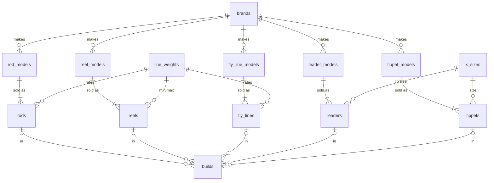

# Database Schema & Backend — Design Record

**Date:** 2026-10-11
**Status:** Schema and API skeleton implemented; not yet run against a live MySQL server
**Implementation:** `server/db/migrations/001_init.sql`, `002_seed_lookups.sql`, `server/src/`

This document records *how* we arrived at the RodPartPicker data model, not
only what it is: the starting proposal, the problems found in it, each decision
with the alternatives we weighed, and how the result was verified.

---

## 1. Problem

RodPartPicker lets a user assemble a fly fishing setup (rod, reel, fly line,
leader, tippet) the way PCPartPicker assembles a PC. The database must:

1. Store a catalog of parts with the specs that matter for buying them.
2. Store the specs needed to **check compatibility** between parts.
3. Store **builds**: a named selection of one part per category.

The front end currently runs on mock data (`src/features/builder/api/mockParts.ts`).
The database and API replace it.

## 2. Process

| Stage | What we did | Output |
|---|---|---|
| 1. Initial proposal | Team listed the entities and attributes we knew we needed | 8-table draft (§3) |
| 2. Domain review | Checked the draft against fly fishing domain rules and normalization (3NF) | Findings (§4) |
| 3. Deliberation | Wrote down open questions; team chose an option for each | Decision log (§5) |
| 4. Design | Rewrote the schema around those decisions, MySQL-specific | `001_init.sql` (§6) |
| 5. Backend choice | Compared a hosted backend (Supabase) with a self-built API | Decision D7 (§5) |
| 6. Implementation | Migrations, migration runner, Express API, Vite proxy | `server/` |
| 7. Verification | Type check, lint, live smoke tests (§8) | Results and known gaps |

## 3. Initial proposal

| Table | Attributes |
|---|---|
| Rod | speed, length, price, id (brand/name) |
| Reel | price, id (brand/name) |
| Line | id (brand/name), sink rate, head weight, price |
| Leader | id (brand/name), material, length, strength, price, number in pack |
| Tippet | material, strength, brand/name, price |
| Standard Weights | weight (for 30 ft line heads) |
| Weight | weight (for all rods, reels, lines) |
| Fresh or Salt | fresh or salt |

## 4. Review findings

1. **"Weight" and "Standard Weights" describe the same thing.** A "5-weight"
   is a rating class, defined by AFTMA as the grain weight of the first 30 ft
   of line. One lookup table, one row per class 1–15, serves rods, reels and
   lines. Matching on that class is the main compatibility check.
2. **Reels are rated for a range** (e.g. 4–6 wt), not a single weight, so a
   reel needs a minimum and a maximum.
3. **"Fresh or Salt" as a table can't say "both"**, and a two-row table adds a
   join for nothing. It becomes a column on each product.
4. **`brand/name` as the primary key is fragile.** Names change, composite
   string keys make joins awkward, and one product line comes in many sizes,
   so brand + name doesn't identify one purchasable item.
5. **Missing attributes needed for compatibility:**
   - leader and tippet **X-size** (how anglers match tippet to leader)
   - fly line **type** (floating/sinking) and **taper**
   - rod **line weight** and **pieces**
6. **Missing entity: builds.** The app has a "Completed Builds" page, but
   nothing stored a build.

## 5. Decision log

| # | Question | Options considered | Decision | Why |
|---|---|---|---|---|
| D1 | Which database? | PostgreSQL, MySQL | **MySQL 8.0.16+** | Team choice. 8.0.16 is the first version that enforces `CHECK` constraints |
| D2 | How are prices stored? | One price per item; a `prices` table per retailer | **One price** (`DECIMAL(8,2)`) | Enough for the capstone; a retailer table can be added later without changing existing tables |
| D3 | How is a product line with many sizes modeled? | One flat row per size; model table + variant table | **Two tables per category** (`*_models` + variants) | Brand, name and shared specs aren't repeated on every size; builds point at the exact size bought |
| D4 | Users? | Accounts now; later | **Later** | Builds will be shareable, but not in this iteration. Adding `users` later is one table plus a `user_id` column on `builds` |
| D5 | Backing, flies? | In scope; out of scope | **Out of scope** | Not needed for a core setup |
| D6 | How is X-size stored? | Integer with a `CHECK`; lookup table | **Lookup table** `x_sizes` | Handles heavy sizes (03X–01X) cleanly, stores diameter, and its id order makes "one size finer" a simple `+1` |
| D7 | Backend? | Supabase (hosted); our own API | **Our own Express + mysql2 API** | Supabase is Postgres-only. A small REST API is within scope and shows our own engineering |
| D8 | Name of the line tables | `lines`, `fly_lines` | **`fly_lines`** | `LINES` is a MySQL reserved word and would need backticks everywhere |
| D9 | Where do compatibility rules live? | DB constraints; application code | **Application code** | A builder should *warn* about a mismatch and still let the user save |

## 6. Final schema



**What lives where:**

| Category | Model table holds | Variant table holds |
|---|---|---|
| Rod | brand, name, action, water | line weight, length (in), pieces, price |
| Reel | brand, name, water | size label, min/max line weight, price |
| Fly line | brand, name, type, taper, sink rate, water | line weight, head weight (grains), price |
| Leader | brand, name, material, water | length (ft), tip X-size, strength, pack count, price |
| Tippet | brand, name, material, water | X-size, strength, spool yards, price |

**Lookups:** `brands`, `line_weights` (seeded with the AFTMA table), `x_sizes` (seeded 03X–8X).

**Integrity choices:**

- **Money** is `DECIMAL(8,2)` with `CHECK (price >= 0)`. Floating point would introduce rounding errors.
- **Natural uniqueness** is enforced with `UNIQUE` keys: `(brand_id, name)` on models, and the identifying spec combination on variants.
- **A floating line has no sink rate.** A `CHECK` ties `sink_rate_ips IS NULL` to `type = 'floating'`.
- **Delete behavior:**

  | When this is deleted | What happens | Rule |
  |---|---|---|
  | A model | Its variants are deleted too | `CASCADE` |
  | A variant used in a build | The build stays; that part slot becomes empty | `SET NULL` |
  | A brand or lookup row still in use | The delete is refused | default (`RESTRICT`) |

- **`min_line_weight <= max_line_weight` on reels is validated in the API.**
  MySQL restricts `CHECK` constraints on columns that are also foreign keys.

## 7. Compatibility rules (to be implemented in the API/UI)

| Check | Rule |
|---|---|
| Rod and line | `rod.line_weight = fly_line.line_weight` (warn; some anglers go one size up) |
| Reel and line | `fly_line.line_weight BETWEEN reel.min_line_weight AND reel.max_line_weight` |
| Line head | `head_weight_grains` within the line weight's `grains_min`–`grains_max` |
| Leader and tippet | tippet `x_size_id` equals leader's or is one higher (one size finer) |
| Saltwater build | every part's `water` is `salt` or `both` |

## 8. Backend architecture

```text
Browser ──/api/*──▶ Vite dev server (5173) ──proxy──▶ Express (3001) ──mysql2 pool──▶ MySQL
```

- **Vite proxies `/api`** to Express, so the browser sees one origin and we don't need CORS in development.
- **Node 24 runs the server's TypeScript directly** (type stripping), so there is no build step. `tsc -b` still type-checks `server/` through `tsconfig.server.json`.
- **Every request body and parameter is validated with zod.** Every query uses `?` placeholders.
- **The migration runner** (`pnpm db:migrate`) applies numbered `.sql` files once each and records them in `schema_migrations`.

See `server/README.md` for setup, endpoints and conventions.

## 9. Verification

| Check | Result |
|---|---|
| `tsc -b` (app, node and server projects) | Passes |
| `oxlint` on `server/` and `vite.config.ts` | No findings |
| API boots; `GET /api/health` | `{"api":"ok","db":"unreachable"}` (no MySQL server on the dev machine yet) |
| Unknown category `GET /api/parts/boat` | `404` with message |
| Invalid build `POST /api/builds {"name":""}` | `400` with zod issues |
| Unknown route `GET /api/nope` | `404` JSON |
| Vite proxy: `GET :5173/api/health` | Reaches Express |
| Migrations executed against MySQL | **Not yet run.** Needs MySQL Server installed |

## 10. Next steps

1. Install MySQL Server 8, run `pnpm db:migrate`, confirm `/api/health` reports `db: ok`.
2. Write `003_seed_catalog.sql` with a small real catalog to replace `mockParts.ts`.
3. Point the builder feature's `api/` at `apiFetch('/parts/…')`.
4. Implement the compatibility checks in §7.
5. Later: `users` table + auth, then shareable builds.
