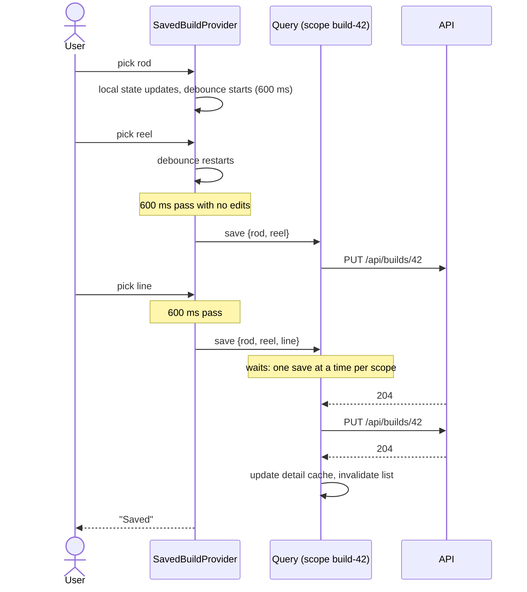
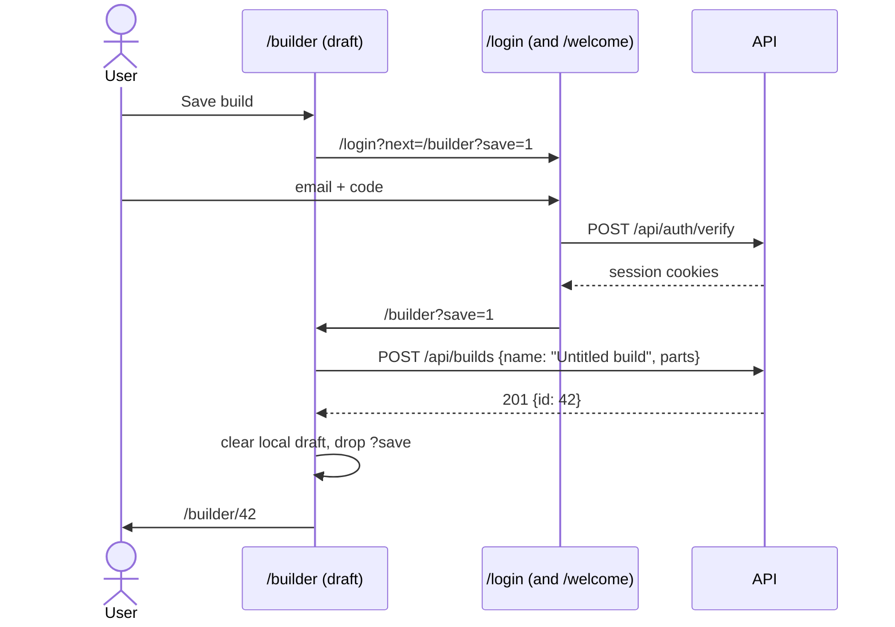

# Saved Builds Design

**Date:** 2026-11-12
**Follows:** `docs/superpowers/specs/2026-11-09-auth-design.md` (spec 1). This spec is the first half of its "spec 2".
**Updates:** D4 in `docs/database/schema-design.md` (`builds.user_id` arrives)
**Followed by:** a separate spec for the public catalog, modeled on PCPartPicker's [Completed Builds](https://pcpartpicker.com/builds/)

## Goal

Move builds from the browser into the user's account. Today the builder keeps one in-progress build in `localStorage`, and the `/api/builds` routes have no owner: anyone can read, change or delete any build. After this spec, a signed-in user owns any number of named builds. The builds follow them across devices, and only they can see or change them.

The model is PCPartPicker's **saved part lists**. Anyone can build a list without an account. Saving it needs one, and a saved list you open is the list you edit. PCPartPicker's *completed builds* are a separate published object created from a part list. That's the catalog spec, and this design leaves room for it (see "Out of scope").

The team will present this work, so every choice in "Decisions" records its reason.

## Success criteria

- A signed-out visitor can still use the builder. Their draft survives a reload, as it does today.
- **Save build** on a signed-out draft goes through sign-in (and `/welcome` for a new account), then creates the build and opens it at `/builder/:id`.
- A saved build opened at `/builder/:id` is edited directly. Changes autosave, and after any burst of edits the last one is what the server keeps.
- A user can list, open, rename and delete their builds from **My Builds** (`/builder/saved`).
- The API never returns, changes or deletes another user's build. Requests for one get the same 404 as a missing build.
- After sign-out or session expiry, the next user on that browser never sees the previous user's builds, not even from cache.
- Every API case in "Testing" has a passing pytest case, and every step of the manual script passes in the browser.
- `uv run pytest`, `npm run build` and `npm run lint` pass.
- Each PR is under 500 lines, excluding pure deletions and generated files (`pnpm-lock.yaml`, the shadcn component).

## Out of scope

- **The public catalog**: a public/private flag, a Completed Builds page, build write-ups, photos, ratings and comments. That spec will add a separate published-build object that points at a saved build, following PCPartPicker's split, so `builds` doesn't need reworking.
- A server-side draft for signed-in users (see "Decisions").
- Sharing a private build by link, and duplicating ("Save as new") a build.
- A frontend test runner (see "Testing").
- Moving drafts between devices without saving them.

## Decisions

| Decision | Choice | Reason |
|---|---|---|
| Scope | Ownership plus a My Builds list; the catalog gets its own spec | The catalog adds read access to other users' builds and new pages. It's a separate slice, and keeping it out keeps this spec and its PRs small |
| Signed-out users | Keep a local draft; saving it requires sign-in | Visitors can try the builder before signing up, which matters for a parts picker. It's what PCPartPicker does, and it keeps the existing draft code |
| Editing a saved build | Edit it directly, with autosave | One source of truth per build and no "unsaved changes" state to track. The existing `PUT /api/builds/{id}` already fits it |
| Server draft for signed-in users | No | It would add a second "draft" concept on the server. Saving a build already makes it available on every device |
| Another user's build | 404, the same as a missing build | A 403 would confirm that the id exists. With 404, ids reveal nothing |
| Owner on create | Taken from the access cookie, never the request body | A client can't create builds for someone else. The schema has no `userId` field to send |
| Existing `builds` rows | Deleted by the migration | The frontend never wrote builds, so the rows are dev and test leftovers. Deleting them lets `user_id` be `NOT NULL` from the start |
| Deleting a user | `ON DELETE CASCADE` to their builds | There's no account deletion yet. When it comes, it won't leave orphaned builds |
| Data fetching | TanStack Query (`@tanstack/react-query`) as the app's single data layer | It gives caching, invalidation, request status and ordered mutations. The public catalog (paginated, filtered lists) needs it most, and adopting it now keeps one pattern in the codebase |
| Existing fetches | The catalog load (`BuilderLayout`) and the compatibility check move to Query | Otherwise the app would have two fetching patterns. Both are plain read queries, so the move is small and changes no behavior |
| Editing state | Local React state seeded once from the query, not the query cache itself | A background refetch must never overwrite an edit in progress (for example, a rename halfway through typing) |
| Save ordering | Debounced full-build `PUT`s, queued with mutation `scope` | Each `PUT` sends the whole build, so an earlier request landing after a later one would undo the latest edit. Running saves one at a time, in order, means the last edit always lands last |
| Saving after sign-in | Only when the user clicked **Save build** (a `save=1` URL intent) | A build is created only when someone asked for one. Signing in to check your builds doesn't turn leftover picks into a surprise "Untitled build" |
| New build name | "Untitled build", renamed inline on the builder page | No extra dialog in the sign-in round trip |
| My Builds URL | `/builder/saved` | It keeps `/builds` free for the public catalog, as PCPartPicker does. It also nests under `BuilderLayout`, which already loads the catalog the list needs for totals |
| Delete confirmation | shadcn `AlertDialog` | It's accessible and keyboard-friendly, unlike `window.confirm`, and it builds on the `radix-ui` package already installed |

## Data model

Migration `api/migrations/019_build_owners.sql`:

```sql
-- The frontend never wrote builds, so existing rows are dev/test leftovers
DELETE FROM builds;

ALTER TABLE builds
  ADD COLUMN user_id INT UNSIGNED NOT NULL AFTER id,
  ADD CONSTRAINT fk_builds_user FOREIGN KEY (user_id) REFERENCES users(id) ON DELETE CASCADE,
  ADD INDEX idx_builds_user_updated (user_id, updated_at);
```

- `idx_builds_user_updated` serves "my builds, newest first". MySQL also uses it for the foreign key, so `user_id` needs no separate index.
- `updated_at` keeps its `ON UPDATE CURRENT_TIMESTAMP`. MySQL bumps it only when a value actually changes, so an autosave with nothing new doesn't reorder My Builds.
- The `Build` model in `api/app/builds/models.py` gains `user_id: Mapped[int] = mapped_column(ForeignKey("users.id"))`.

## API (`api/app/builds/`)

All routes take `CurrentUserId`, so a request with no valid access cookie gets a 401 before any database work.

| Route | Behavior |
|---|---|
| `GET /api/builds` | The caller's builds, `ORDER BY updated_at DESC, id DESC`. The `id` tiebreak keeps the order stable when two saves land in the same second |
| `POST /api/builds` | Creates a build with `user_id` set to the caller. Returns 201 with `BuildOut` |
| `GET /api/builds/{id}` | The build if the caller owns it, else 404 |
| `PUT /api/builds/{id}` | Replaces name and parts if the caller owns it, else 404. Returns 204 |
| `DELETE /api/builds/{id}` | Deletes it if the caller owns it, else 404. Returns 204 |

- One helper, `_get_owned_build(db, build_id, user_id) -> Build`, does every lookup by id. It raises the 404 for "missing" and for "not yours" alike, so no route can forget the ownership check.
- `BuildIn` and `BuildOut` don't change. `BuildOut` doesn't expose `userId`, since the client already knows who it is. A `userId` in a request body is ignored, like any unknown field.
- The existing foreign-key handling in `_commit` (400 "Referenced part does not exist") stays.

## Frontend

### Data layer

- `pnpm add @tanstack/react-query`. No devtools package.
- `src/lib/queryClient.ts` exports the one `QueryClient`. Its single default: **queries don't retry 4xx `ApiError`s.** A 404 or 401 shows right away instead of after three backoff retries. Network errors and 5xx keep Query's default retries.
- `main.tsx`: `QueryClientProvider` wraps `AuthProvider` (auth needs the cache). `BuildProvider` comes out of `main.tsx`; the providers become route layouts (see "Routes").
- **Cache clearing:** `AuthProvider` calls `queryClient.removeQueries({ queryKey: ['builds'] })` on sign-out and in its `onSessionExpired` listener. The catalog and compatibility caches stay, since they're public.
- **Query keys** live next to the fetchers that use them, so invalidation can't drift from the keys used to read:
  - `src/features/builder/api/builds.ts`: `buildKeys.all = ['builds']`, `buildKeys.list() = ['builds', 'list']`, `buildKeys.detail(id) = ['builds', id]`
  - `['catalog']` in `api/parts.ts`, `['compatibility', query]` in `api/compatibility.ts`

### Migrated fetches (no behavior change)

- **`BuilderLayout`:** `useQuery({ queryKey: ['catalog'], queryFn: ({ signal }) => fetchCatalog(signal), staleTime: Infinity })`. `isPending`, `isError` and `refetch()` replace the `useState`/`useEffect`/`attempt` plumbing. Leaving `/builder` and coming back no longer refetches the catalog.
- **Compatibility check in `BuilderPage`:** `useQuery({ queryKey: ['compatibility', query], queryFn, enabled: hasPairToCheck })`. Results are keyed by the query string, so the `result.query === query` guard goes away: the previous selection's warnings can't show for the new one. Errors still go to `console.error`, and the page shows no warnings. No `placeholderData`, because that would show the old selection's warnings during a refetch.

### Builds API module (`src/features/builder/api/builds.ts`)

- `listBuilds`, `getBuild`, `createBuild`, `updateBuild` and `deleteBuild`, all through `apiFetch`.
- `toBuild(apiBuild): Build` maps `rodId: 12` to `rod: 'rod-12'` (and `flyLineId` to `line`).
- `toBuildIn(build, name, getPart)` maps the other way and **sends only ids that resolve in the catalog**, so a part removed since the build was saved can never trigger the API's 400.

### Context

`BuildContextValue` becomes a discriminated union, so the type checker makes each page handle both modes:

```ts
type BuildContextValue = {
  build: Build
  basePath: string // '/builder' or '/builder/42'
  selectPart: (component: ComponentType, partId: string) => void
  removePart: (component: ComponentType) => void
  clearBuild: () => void
} & (
  | { kind: 'draft' }
  | {
      kind: 'saved'
      id: number
      name: string
      rename: (name: string) => void
      saveStatus: 'saved' | 'saving' | 'error'
      retrySave: () => void
    }
)
```

`ComponentRow`, `BrandMenu` and `BrandPartsPage` build their links from `basePath` instead of a hardcoded `/builder`. That way, picking a rod while editing build 42 stays in build 42.

### `LocalBuildProvider`

Today's `BuildProvider`, renamed. It still uses the `rpp:build:v2` key and the same validation of stored entries. It adds `kind: 'draft'` and `basePath: '/builder'`.

### `SavedBuildProvider`

1. **Load:** `useQuery({ queryKey: buildKeys.detail(id), queryFn })`. Loading shows "Loading build…". A 404 shows "Build not found" with a link to My Builds. Other errors show the message and **Try again**.
2. **Seed once:** an inner component keyed by `buildId` takes the loaded build as its initial local state. From then on, local state is the source of truth for this page, and later refetches don't touch it.
3. **Autosave:** every change to parts or name restarts a 600 ms debounce. When it fires, a `useMutation` with `scope: { id: \`build-${id}\` }` sends the full build with `PUT`. Query runs mutations with the same scope one at a time, in order.
   - On success, it writes the values it sent into the `buildKeys.detail(id)` cache (so reopening the build is instant and current) and invalidates `buildKeys.list()`.
   - `saveStatus` is `'saving'` while a debounce is pending or a request is running, `'error'` after a failed save, and `'saved'` otherwise.
   - On error, the edits stay in local state. **Retry** resends the current state, and so does the next edit.
4. **Leaving:** unmounting flushes a pending debounce immediately, so navigating away doesn't drop the last edit. While `saveStatus` is `'saving'`, a `beforeunload` handler asks before the tab closes.
5. **Rename:** the page title is an inline, editable name. It's trimmed and limited to 1–120 characters (matching `BuildIn`). An empty name shows an inline error and isn't sent.

**Known limitation:** if the 30-day session expires mid-edit, the last unsaved change can be lost. `RequireAuth` sends the user to sign in, then back to the build.

### Saving a draft

The draft `BuilderPage` shows **Save build**, disabled while the draft is empty.

- **Signed in:** a `useMutation` calls `createBuild` with the draft's parts and the name "Untitled build". On success it clears the local draft, invalidates `buildKeys.list()` and navigates to `/builder/:id`. While pending, the button reads "Saving…". On error, an inline message appears and the draft is untouched.
- **Signed out:** the button goes to `/login?next=%2Fbuilder%3Fsave%3D1`. `safeNext` already keeps query strings, and `/welcome` passes `next` along. Back on `/builder?save=1` with `status === 'authenticated'`, the page runs the same save once and removes `save` from the URL (`replace`).
  - A ref marks the save as started. React StrictMode runs effects twice in development, and refs survive that re-run, so the build is created once.
  - If the draft is empty by then (for example, another tab cleared it), the page only removes the parameter.

### My Builds page (`MyBuildsPage`)

- `useQuery({ queryKey: buildKeys.list(), queryFn: listBuilds })`.
- A table: **Name** (links to `/builder/:id`), **Parts** ("3 / 5"), **Total** (from the catalog, through `formatPrice`), **Last edited** (`Intl.DateTimeFormat`) and **Delete**.
- **Delete** opens an `AlertDialog` (`src/components/ui/alert-dialog.tsx`, added with the shadcn CLI). Confirming runs a `useMutation`. On success it invalidates `buildKeys.list()` and removes `buildKeys.detail(id)`.
- Empty state: "No saved builds yet" with a **Start a build** link to `/builder`. A **New build** button to `/builder` is always in the header.
- Loading and error states match `SavedBuildProvider`'s.

### Routes (`src/routes/AppRoutes.tsx`)

```
/builder                              BuilderLayout (catalog query)
├── (LocalBuildProvider)              pathless layout route
│   ├── index                         BuilderPage
│   └── :component/:brand             BrandPartsPage
├── saved                             RequireAuth → MyBuildsPage
└── :buildId                          RequireAuth → SavedBuildProvider
    ├── index                         BuilderPage
    └── :component/:brand             BrandPartsPage
```

- React Router ranks the static `saved` above the dynamic `:buildId`.
- `SavedBuildProvider` renders the not-found page for a `:buildId` that isn't a positive integer, without calling the API.
- `UserMenu` gains a **My Builds** item linking to `/builder/saved`. It links by path string, so the auth feature imports nothing from the builder feature.
- The **Completed Builds** nav link stays a placeholder until the catalog spec.

### Placement

Everything new on the frontend lives in `src/features/builder/` except `src/lib/queryClient.ts` and the shadcn `alert-dialog.tsx`. The barrel adds `LocalBuildProvider`, `SavedBuildProvider` and `MyBuildsPage`, and drops `BuildProvider`. When the catalog feature needs build types, they move to `src/types`.

## Flows

### Autosave



### Saving a signed-out draft



## Error handling

| Failure | Where | What the user sees |
|---|---|---|
| Access token expired (401) | any builds call | Nothing: `apiFetch` refreshes once and retries |
| Session gone (refresh fails) | any builds call | `AuthProvider` goes anonymous and removes the `['builds']` cache; `RequireAuth` sends them to `/login?next=…` and back afterward |
| Build missing or not theirs (404) | `SavedBuildProvider` | "Build not found" with a link to My Builds, right away (no retries) |
| Part removed from the catalog | load or save | The server's `ON DELETE SET NULL` already cleared it; `toBuildIn` never sends an unknown id |
| Invalid name (422) | rename | Prevented by the inline check; the API still validates as the backstop |
| Network or 5xx on save | autosave | "Couldn't save · Retry"; edits stay local, and the next edit retries |
| Network or 5xx on load | My Builds, saved build | Error message and **Try again**, after Query's retries |
| Draft save fails | draft page | Inline error; draft untouched; button enabled again |

## Testing

### API (pytest, `api/tests/test_builds.py`)

Fixtures (`api/tests/conftest.py`):
- `make_build(**columns)` accepts `user_id`. When none is given, it creates an owner with `make_user`, so the factory stays easy to call.
- Route tests sign in with the existing `login` fixture. Tests that need a second user sign in a second client.

Cases:

| Case | Expect |
|---|---|
| Each route with no session | 401 |
| `POST` | 201, and the row's `user_id` is the caller |
| `POST` with `userId` in the body | Ignored; the owner is the caller |
| `GET` list | Only the caller's builds, `updated_at DESC, id DESC` |
| `GET`, `PUT` and `DELETE` on another user's build | 404 with "Build not found"; that user's row is unchanged (checked after `db.rollback()`) |
| Existing CRUD and validation cases | Still pass, signed in |
| Deleting a user | Their builds are deleted (cascade) |

### Frontend

There is no frontend test runner, and adding one is a separate tooling decision. Each web PR is verified by:

1. `npm run build` (tsc) and `npm run lint` passing.
2. The relevant steps of the manual script below, written into the PR description so a reviewer can repeat them.
3. Running those steps in the browser (Vite dev server plus the API) before opening the PR, with the results in the PR description.

Manual script:

1. Signed out: pick parts, reload. The draft is still there.
2. Signed out: **Save build**, sign in. You land on `/builder/:id`, the build exists, and `/builder` shows an empty draft.
3. Step 2 with a new account: you pass through `/welcome` and still land on the new build.
4. On a saved build, change several parts quickly, then reload. The last pick is the one kept.
5. Rename the build. Clear the name: an inline error shows, and no request is sent.
6. Stop the API while editing: "Couldn't save" shows. Restart it and click **Retry**: "Saved".
7. A second account opens the first account's `/builder/:id`: "Build not found".
8. Sign out, then sign in as another user. My Builds never shows the previous user's builds.
9. Delete a build from My Builds. The dialog confirms, then the row disappears.
10. Regression: compatibility warnings still update as parts change, and the catalog error page's **Try again** works (stop the API, load `/builder`, restart, click it).

## Documentation

- `docs/builds/saved-builds.md`: how saved builds work, for the presentation. It covers the ownership rules, the two providers, and the two sequence diagrams from "Flows", each tied to the code that implements it (in the style of `docs/auth/sessions.md`).
- `docs/database/schema-design.md`: D4 notes that `builds.user_id` arrived in migration 019, the ER diagram gains `users ||--o{ builds : owns`, and the doc links this spec.
- `CLAUDE.md`: the builder's persistence (local draft plus saved builds), TanStack Query as the data layer, and `src/lib/queryClient.ts`.

## PR breakdown

| # | PR | Depends on | Contents |
|---|---|---|---|
| 1 | **API: build ownership** | none | Migration 019, model column, `_get_owned_build`, owner-scoped routes, fixture changes, the pytest cases above, the `schema-design.md` update |
| 2 | **Web: adopt TanStack Query** | none (parallel to 1) | The dependency, `queryClient.ts`, the provider in `main.tsx`, the `BuilderLayout` and compatibility migrations; manual step 10 |
| 3 | **Web: saved builds in the builder** | 1, 2 | `api/builds.ts` and keys, cache clearing in `AuthProvider`, the context union, `LocalBuildProvider` and `SavedBuildProvider`, `basePath` links, the nested routes, autosave and status, inline rename, **Save build** with the sign-in round trip, `docs/builds/saved-builds.md`; manual steps 1–7 |
| 4 | **Web: My Builds page** | 3 | `MyBuildsPage`, `alert-dialog.tsx`, the `UserMenu` item, the `CLAUDE.md` update; manual steps 8–9 |

After PR 3, a user can save a build and reopen it from its URL. PR 4 makes their builds findable.
